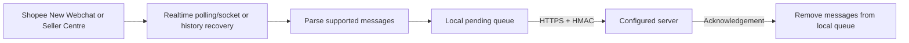

# Shopee provider

Shopee Seller Chat supports New Webchat as its primary surface and the
Seller Centre embedded Chat panel as fallback:

- New Webchat: `https://seller.shopee.co.th/new-webchat/conversations`
- Seller Centre: other seller pages, including `/portal/chat-management`

Retired `/webchat` pages are not supported. The `/webchat/api/...` API paths
are still used by New Webchat and remain supported.

## How it works

1. The seller signs in and opens New Webchat. Seller Centre remains a fallback
   (the first manual sync can open its Chat panel).
2. On Seller Centre, the extension observes Shopee's authenticated conversation
   list and realtime sync polling. On New Webchat pages it reads the existing chat
   socket.
3. For missed messages, it requests recent conversation history using the open
   Seller Chat session.
4. Supported messages enter a local pending queue.
5. The extension sends an HMAC-signed batch to the configured HTTPS server.
6. The local scan cursor advances after messages are durably queued in the
   extension. The queue removes them only after the server acknowledges the
   batch.

See the shared [`omnichat.message_batch` v1 contract](../payload-contract.md).

The Bridge uses the shared version 3 configuration envelope for new exports. A
configuration file may contain entries for other providers; this Shopee
adapter ignores those entries and ignores fields it does not use. Version 2
configurations remain supported for existing installations.

The extension **does NOT save or send the seller's Shopee password, cookies, or
login tokens**. Request headers remain in the Shopee page's memory.

The extension status records the active surface (`new-webchat` or `seller-centre`),
its named capabilities, and the realtime transport (`polling` or `socket`). A
command is rejected with an explicit initialization error when the selected
surface has not exposed the required request profile.

The popup separates the Seller Centre connection states so a live server
connection is not confused with a ready Shopee chat: **CONNECTED · OPEN CHAT**
means the mini-chat is closed, **CONNECTED · INITIALIZING** means it is open
but still capturing its request templates, and **CONNECTED · CHAT READY** means
the surface can sync. The first manual sync can open the mini-chat automatically.

**Open chat and sync automatically** is an optional, device-local preference
shown above the Sync button on Seller Centre. It is off by default. When enabled,
each new Seller Centre page load opens the mini-chat once, detects the current
shop, and starts the normal automatic sync. Turning it off does not close an
already-open chat or cancel a sync that is already running.

The shared **Recover provider tabs automatically** preference is also off by
default. When enabled, recovery can create at most one tracked Shopee tab. A
redirect, sign-in page, failed bridge, or closed tracked tab stays associated
with that provider record. Recovery reinjects the bridge first, then retries
the same tab with capped backoff; it never creates a replacement while the
tracked tab still exists. Closing the tracked tab allows one replacement on a
later retry.

Chrome and the New Webchat or Seller Centre chat tab must remain open for realtime
capture. When the laptop or Chrome is off, nothing is captured or sent.
Recovery may fetch missed messages after the seller returns. The bridge keeps
request templates only in page memory; it never persists Shopee cookies,
headers, or login tokens. Captured message bodies remain in the local pending
queue until acknowledged.

## Optional live replies

Your server can send one text, image, or product reply to a configured seller
browser Shop ID on either supported surface. Text and image replies may quote
an existing provider message. The extension uses the authenticated request
profile of the selected surface: Seller Centre sends through its page-native
mini-chat request, while New Webchat uses its secure sender. It never
silently sends a Seller Centre command through standalone endpoints and never
transfers Shopee cookies, passwords, or login tokens.

- A complete optional command route can address the conversation directly. Otherwise
  the bridge resolves it through its shop-scoped cache and conversation lookup.
- Outbound replies never create or navigate to a Shopee tab. An Admin reply is
  sent only when an already-open New Webchat or Seller Centre chat tab is
  available; otherwise it fails with an actionable error.
- If the browser is offline or the target conversation is unavailable, sending
  fails. There is no remote command queue or retry.
- The bridge uses a short-lived ticket and browser presence. Target-server
  storage and retention are deployment-specific.

New Webchat additionally supports outbound MP4 video (up to 5 MB) through the
generic `send_video` command when its advertised capability is ready. Mini-chat
video remains unsupported. Upload and sending share the command deadline and
never retry an uncertain send. See [routing and video contracts](../payload-contract.md#shopee-conversation-routing).

Ready, shop-matching New Webchat tabs take precedence over mini-chat. Recovery
maintains the primary New Webchat tab in the background without activating it.

## Sync and recovery

Shopee sync follows the single shop in the current browser login session. Saved
configuration and previously detected shops do not make another shop available
in that session. The extension refreshes session detection before syncing and
skips other shops with a login hint. LINE OA retains its multi-account sync.

Logging out or changing the login shop clears Shopee request templates and
interrupts recovery for the previous shop. Open Webchat in the new session so
its fresh conversation and message requests initialize the bridge. Automatic
provider-tab recovery uses a generic Shopee URL and does not require the old
shop to remain logged in; account detection failures do not block tab recovery.

Session-change and skipped-sync logs contain shop IDs and reasons. Initialization
timeouts record which request template is missing, without cookies, tokens,
request bodies, or customer messages.

Bootstrap, resume, retry, and **Sync messages** use one checkpointed sync flow.

- Without a completed checkpoint, initial sync covers the last 1 day, reading
  the 10 newest conversations and at most 25 newest messages from each.
- With a checkpoint, sync follows changed conversations back to their cursor
  or the last 5 days, whichever is newer. Polling ignores older conversation
  summaries and messages. There are no additional caps on recent traffic.
- Only explicit `history_days` settings allow older historical imports within
  their configured date window.
- Conversation-list and message-history pages are requested sequentially.
- Every history page is saved to the local queue immediately. A conversation
  cursor advances only after all required pages for that conversation finish.
- Realtime capture starts only after bootstrap completes and pauses while a
  recovery scan is incomplete. The scan catches messages received during that
  window before realtime cursor advancement resumes.
- The global conversation-list watermark advances only after the complete scan
  finishes. An interrupted scan restarts discovery and skips work already
  covered by conversation cursors.
- Load, reconnect, and visible focus can resume sync at most once every five
  minutes. **Sync messages** and **Retry now** bypass that window.
- Opening the Seller Centre mini-chat manually starts the same debounced
  automatic sync path, so the chat does not need to be opened before syncing.
- Failed collector delivery retries on an account-scoped exponential schedule,
  capped at 30 minutes. Retry never calls Shopee.
- Shopee recovery requests are spaced by at least one second.
- If a page reload interrupts a recovery response, the extension marks the sync
  failed after 90 seconds and shows a manual-refresh action instead of leaving
  the popup in an indefinite loading state.
- If Chrome restarts the extension service worker during recovery, a persisted
  in-progress scan is resumed automatically when the worker starts again.
- If reloading the extension invalidates a content bridge in an already-open
  Seller Centre tab, the worker reattaches it without refreshing that page.
- An interrupted page-side recovery is cancelled before that reattached bridge
  retries, so a stale `Recovery is already running` state cannot block sync.

## Data sent

- Inbound and outbound text messages
- Supported image and video URLs
- Buyer IDs, display names, avatar URLs, and timestamps

## Setup

Use the [shared Shopee and LINE setup](../setup.md). Configure the detected
Shop ID, not a Shopee user ID. Only the current browser login shop can sync;
other saved accounts remain configured but unavailable in that session.

See the [privacy policy](../../PRIVACY.md) and
[provider notice](../../README.md).
