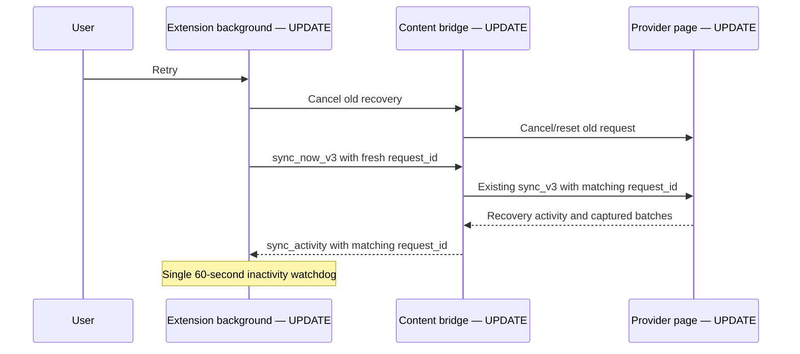

# Active-shop connection recovery

**Planned — source under review, not deployed.** Each Chrome profile may import the same configuration for all shops. Live sockets, API pings and leader actions should follow the shop identified by the open Shopee session. Saved configuration is not proof of a live session.

[Shared overview](https://github.com/kaojai-ai/kj-wiki/blob/docs/omnichat-reliability-plan/openwiki/repositories/omnichat-bridge.md) · [Delivery issue](https://github.com/kaojai-ai/backlog/issues/65)

## System flow

```mermaid
sequenceDiagram
    participant S as Shopee chat tab — UPDATE
    participant E as Extension — UPDATE
    participant B as Bridge Lambda — UPDATE logging
    participant D as DynamoDB — UNCHANGED
    E->>S: Chrome message: get_provider_status_v3
    S-->>E: current_provider_account_id and capture freshness
    E->>B: Existing authenticated ticket and WebSocket status
    B->>D: Existing presence contract
    Note over S,E: Bounded requests; only signed-in shop owns a socket
```

## Component changes

| Owner | Before | Planned behaviour |
| --- | --- | --- |
| omnichat-bridge: background | Saved detected shops can all own live connections | Resolve current session; close inactive sockets; retain configuration and queued messages |
| omnichat-bridge: recovery | Retry backoff can hide a recovered tab | Keep health checks and bridge repair running; never automatically reload provider tabs |
| omnichat-bridge: capture | Fetch or JSON parsing can hold the polling lock indefinitely | Bound provider requests to 15 seconds; release lock; ignore completion from an old shop session |
| omnichat-bridge: readiness | Successful list polling can hide message-history failure | Report capture failure and apply existing freshness checks to ready status |
| omnichat-bridge: delivery | Upload can delay watchdog; retry timestamp is not enforced | Bound upload/log requests to 15 seconds; independent transport repair; respect automatic retry time |
| omnichat-bridge: popup | All configured shops can look ready | Show only the signed-in Shopee shop; hide inactive shops; show unknown explicitly |
| stateless-apps: bridge Lambda | Connection log context can use global tenant | Use authenticated ticket tenant context, without new database reads |

## Database and contracts

**Database changes: none.** No tables, indexes, grants, migrations or new infrastructure. Existing HMAC, ticket, message queue and WebSocket contracts remain unchanged. The extension's local `active_in_profile` flag is private browser storage, not a server contract.

Example existing status: `{ "ready": false }` when capture is stale or failed. Existing `current_provider_account_id` identifies the signed-in shop; configured IDs are not substituted when detection is unavailable. A missing session can temporarily show unknown until the tab responds.

## Impact and validation

1. Prevent indefinite stalls and misleading readiness. Tests cover hung fetch/body, recovery during backoff and session changes.
2. Isolate profile ownership. Test switching between two configured shops, retiring predecessor sockets and preserving queued messages.
3. Make support status understandable. Only the signed-in Shopee shop is shown using the existing plain account row, without an extra card border or session label. LINE retains multiple OA accounts per profile. Already captured queues for inactive shops may finish uploading without accessing those provider sessions.
4. Correct tenant attribution without per-heartbeat logging or new network calls.

No heartbeat frequency increase, provisioned concurrency or warm-up scheduler. Fewer inactive connections should reduce unnecessary traffic, but exact savings require post-release measurement. Provider read/upload deadlines do not retry outgoing customer sends or alter uncertain-send handling.

## Rollout and remaining work

Extension and logging changes are independently compatible; neither requires a schema rollout. Merge and deployment require authorization. Validate the released extension with multiple Chrome profiles sharing config, provider login/switch, tab refresh, failed history reads, and an actual two-hour WebSocket rotation.

The production bridge was observed without APP_ENV/KJ_RUNTIME_ENVIRONMENT even though current Terraform declares them. Reconcile through the existing reviewed infrastructure workflow separately; do not guess environment from a socket URL. No production configuration is changed by this patch.

Heartbeat acknowledgements and half-open socket detection remain phase two. The observed customer disconnect after two hours is not conclusively explained by server logs alone. This patch addresses reproduced failure paths; production resolution must be verified after rollout. Existing send-worker execute/ack budgets stay unchanged.

## Manual retry and timeout ownership

**Planned refinement.** Manual Retry replaces the active recovery, including an automatic attempt. It aborts and detaches the old run, sends a bounded cancellation, resets the selected Shopee page recovery, and starts a fresh run with a new attempt ID. Duplicate clicks during cancellation share one restart. Automatic triggers join the current run. Capture queues and cursors remain; outgoing customer sends are never replayed by this action. The popup keeps Retry available during syncing and ignores responses from superseded clicks.



| Limit | Owner and purpose |
| --- | --- |
| 15-second request deadline | Shopee polling/initial-history fetch and body reads; background ingestion/log uploads. Cancels stuck I/O. |
| 60 seconds without progress | Background recovery handoff. Matching activity from the selected tab refreshes it; expiry cancels that request. No fixed total-sync cutoff. |
| 5-second bridge control checks | Status, ping and cancellation acknowledgements. A dead tab cannot hold the Retry handoff indefinitely. |
| Existing operation-specific limits | Surface preparation uses its 30-second page wait plus a 35-second transport guard; local queue acknowledgements, WebSocket ticket/handshake, and outgoing-send deadlines remain separate contracts. |

Removed: content-owned recovery inactivity timer and background fixed 90-second sync timer. The progress notification is local Chrome messaging, not a server heartbeat. Content reports `recovery_watchdog_version: 1` in its ping so open tabs with older code are reattached before recovery. No server or database contract changes.

Representative internal contracts: `sync_now_v3 { request_id: "attempt-uuid", provider, provider_account_id }` and `sync_activity { request_id: "attempt-uuid" }`. Only the active attempt from the selected tab refreshes the watchdog. Stale progress cannot overwrite the replacement's status. Cancellation during checkpoint loading prevents a late page-side start.

Acceptance covers a hung initial fetch/body followed by successful retry, a long recovery making progress past 90 seconds, silence cancellation, duplicate Retry clicks, cancellation during checkpoint loading, stale-tab progress and late completion of a superseded run. Actual installed-extension recovery still needs release validation.


### Popup processing feedback (Planned)

The existing status area now distinguishes account detection, opening provider chat, server connection recovery, live Shopee connection readiness, and message recovery phases. An empty discovery result does not imply missing configuration: saved provider configuration produces a waiting-for-account state; missing configuration is shown after discovery completes. Retry feedback survives storage refreshes until actual recovery progress takes over. A completed history check does not imply that live commands are ready. No extra polling, server requests, database changes, cards, or account badges are added. Current provider progress comes from existing local storage fields, including `provider_realtime_connected`.

Popup status colors use neutral gray for processing/waiting/setup, green for confirmed ready/success, and red for failures. The existing node badge remains exclusively node/leader status. Account rows and the existing status area show inline spinners for active discovery, chat opening, reconnecting, and sync phases; idle/setup/error states do not. Animation respects reduced-motion preferences. This changes presentation only.


### Multiple Shopee tabs (Planned)

The recovery watchdog rechecks available Shopee tabs instead of remaining attached to a closed mini-chat when another tab is healthy. A fresh healthy status for the matching account clears stale recovery attention in local live state. Existing LINE tab selection is unchanged. Regression coverage includes an old closed mini-chat plus a healthy replacement with automatic recovery both enabled and disabled, and ensures unhealthy or mismatched observations cannot clear attention. Chrome inspection showed this two-tab arrangement and the supplied logs showed successful Shopee recovery; runtime record ownership was not directly inspected. No user tabs are closed or refreshed as part of the investigation.

## Planned reliability repair

**Planned — implementation under review; no release implied.**

Captured messages are acknowledged after local durable persistence. The ACK's
`sent: 0` does not mean forwarding failed: delivery runs independently. Provider
history requests remain sequential. Target forwarding permits two concurrent
account batches, one per account, with FIFO batch slots and coalesced wakeups.
A late upload reconciles only acknowledged identities against the latest queue.
Pending data resumes through the existing startup/watchdog/retry-alarm paths.

Diagnostics enter a bounded 256 KiB serialized buffer, flushed every second or
100 entries; 25% is reserved for warnings/errors. The existing 4 MiB/two-day
persisted retention and remote outbox are preserved. Persistence runs once per
batch rather than once per entry. Worker suspension may lose the unflushed
support-log tail; message persistence is independent and remains mandatory.
Exports flush before reading. Erase discards the buffer and waits for in-flight
log persistence before clearing storage. Buffer stats include drops, queue wait
and persistence duration; sanitized debug timing records cover capture, provider
bridge requests and target requests. These are measurements, not speedup claims.

### Eligibility and uncertainty

LINE selects configured accounts confirmed accessible in the current browser;
Shopee selects the configured shop matching the verified login. A background tab
is sufficient. Missing tabs display waiting-for-tab and are opened only with
existing automatic recovery opt-in. **Planned — readiness grace:** one account policy drives browser readiness,
status reports and command selection for both providers. A missing status response
can retain previously ready evidence for 30 seconds only when the tab, navigation
and account context remain unchanged. Repeated missing responses never move the
deadline; a successful check ends the episode. Unknown sessions without recent
ready evidence cannot send. At grace expiry, replies become unavailable with
`checking_session`; sustained uncertainty becomes `needs_attention` at 60 seconds.
Checks repeat at 5/15 seconds and at the two boundaries. Existing healthy sockets
remain open through provider uncertainty, including after grace expiry; unknown
sessions never create a fresh socket.
Wrong-account evidence, logout, missing tabs, required-capability failures and
confirmed realtime failures block readiness immediately. Navigation, replacement,
configuration changes and worker restart invalidate retained evidence. Invalidating
an unused tab does not close another tab's validated account connection. In-flight
probes share one request per tab/session; navigation epochs and observation order
fence stale results. Session generations survive temporary uncertainty and recovery
to the same account within grace, but change on true context changes or expiry.
They fence queued commands and manual/automatic recovery. A provider waiting for verification must
not occupy the capture/storage queue. Unified recovery selects Shopee before
LINE so a slow LINE access check cannot delay Shopee.

### Readiness compatibility

New reports retain `omnichat.connection_status` version 1 and add paired UUID
`report_id` / positive integer `sequence`. Sequences belong to one WebSocket
connection. The server sends `connection_status_ack` with the matching fields
and `ok: true` only after persistence or an exact persisted retry. Retryable
negative acknowledgements cover missing presence and persistence failure;
stale connections/status and identity mismatch are rejected. The client retries
at 1/2/4/8/16/30 seconds, then allows a later health check to publish again.
The server uses a consistent base-table read and conditional sequence/connection
writes; legacy reports remain supported. Release server support before enabling
the new extension. No relational database migration or new cloud resources.

Progress shows actual pages durably accepted, newly captured messages, pending
count and last measurable progress; unknown totals stay indeterminate. Storage
refreshes are coalesced; the visible log list shows at most 200 rows while
exports contain all retained entries.

[CTO proposal](https://omnichat-reliability-plan.kjteam.chatgpt.site)

After a successful readiness acknowledgement on the current socket, refresh the
server leader result again. Sync completion and acknowledgement alone never
establish leadership; the compatible server release remains required.


### Readiness-grace wire contract (Planned)

During grace, version 1 `connection_status` reports include `ready: true`,
`reason_code: "provider_check_grace"` and optional RFC3339
`readiness_grace_expires_at`. The absolute deadline is retained across checks and
cleared on recovery or expiry. Consumers must stop treating the report as ready
when its deadline expires, even if no replacement report arrives. Release server,
worker and Admin support before the extension. Database changes: none.

Command preflight uses the same account policy, including the retained exact tab
inside grace. The actual page sender retains its exact-account guard, and the
background rechecks generation immediately before the single provider attempt.
No message waits, automatic resends or additional provider attempts are added.
An uncertain provider result remains uncertain and is deduplicated by request ID.

Readiness logs record episode start, recovery duration, grace expiry and the
60-second warning once per episode. Local transport cleanup identifies its reason;
remote close diagnostics include time since the last inbound WebSocket message.

## Manual metadata refresh (0.8.0, Planned)

Account and customer names/avatars are cached locally. First encounters and missing fields are populated from existing provider responses; known fields refresh when the user clicks **Sync messages**. The same action refreshes display metadata for the configured account open in the current tab before starting message recovery in that exact tab. LINE selects the bot in the tab URL, not every account accessible to the login. Unidentified or unconfigured accounts stop the action; it does not fall back to another tab or provider. Metadata failure preserves cached values and does not block message sync. Connection Retry and message Retry do not refresh metadata. Routing/session/access evidence continues updating independently.

Manual refresh verifies the account and reads account/conversation lists only, with a 30-second overall deadline and at most 100 recent conversations. Partial failures keep valid completed results; context changes discard late results. No historical-message crawl, individual customer-profile fetch, message replay, or immediate rewrite of historical Admin customer records is performed. Refreshed information reaches KaoJai through subsequent ordinary ingestion.

The versioned customer cache persists only display metadata and IDs under an opaque configuration/account fingerprint. It is bounded to 1,000 records per account, 5,000 per installation, and 2 MiB (whichever limit is reached first). Storage writes are batched; erasure cancels pending cache work. Display cache failures do not authorize or block sending. Existing server contracts and SQL schema remain unchanged.

Release the related server/worker/Admin readiness compatibility first, then extension 0.8.0. CPU/heap and live incoming-message latency still require comparison on an authenticated provider tab; reduced redundant work is not a measured performance claim.

### Planned: manual provider-tab reload only

Version 0.8.0 removes automatic provider-tab reloads after health-check failures. Health checks and bridge repair continue; opt-in recovery can still open a missing tab with bounded retry backoff. A genuinely stuck page requires the user to reload it manually. Extension-update reloads are unaffected.

### Planned: Shopee socket checks on demand

Version 0.8.0 removes the two-second socket observer. Startup, detected session/page events, and fresh provider-status requests attach listeners to the current socket. The existing minute watchdog requests a fresh page response; command checks also use this path. Message/connect/disconnect listeners remain immediate, and provider message polling is unchanged. A silent socket replacement can take up to the next watchdog check to discover (longer if Chrome delays scheduling). Missing page responses remain uncertainty under the readiness policy, not confirmed logout.


### Planned: bounded message IDs and checkpoint recovery

Version 0.8.0 uses one shared insertion-order ID cache for Shopee event capture and the content bridge used by both providers. Limits are 200 IDs per conversation, 10,000 per provider account, and 20,000 per bridge instance. Reads do not refresh order; eviction removes empty indexes. No timers, cache persistence, or age-based expiry are involved. Account/session changes and disposal release the relevant IDs. These limits do not bound the separate durable pending-message queue.

LINE's former known-message and known-chat sets are removed: they were used to stop pagination, which could hide unrecovered pages. LINE now relies on saved recovery boundaries. This can increase summary-page requests; unchanged old conversations do not require message-history fetches. Memory IDs never authorize sending or determine recovery coverage.

Normal recovery resumes from the saved account watermark and conversation cursor without a five-day cutoff. Initial sync retains at most 10 conversations, 25 messages each, within one day, unless explicit history configuration requests otherwise. Provider retention may still limit available history.

Conversation cursors advance only after every required page for that conversation is durably captured. Failed or cancelled scans keep realtime cursor advancement deferred until recovery completes. LINE advances its successful watermark to scan start, preserving messages arriving during the scan. Invalid provider response shapes and pagination cycles fail recovery instead of reporting completion. Existing pending delivery and single-attempt outgoing sends remain independent.

Validation covers 8/30-day absence, interrupted newest-first pagination, warm/cold recovery equivalence, same-timestamp messages, initial bounds, cache caps, malformed responses, and failed-scan realtime capture. Synthetic cache cardinality is bounded under sustained input; no live heap, CPU, or incoming-latency improvement has been measured.

Synthetic validation: 48,000 distinct IDs retain 20,000 entries under the configured cache cap. For the same three-conversation fixed-checkpoint LINE fixture, message requests are 4 for both warm and fresh bridges; the prior warm-cache shortcut made 1 request. These are fixture counts, not production request-rate or heap measurements.

### Planned: explicit check outcomes

Provider checks distinguish passed, unknown, and failed outcomes through the page/content/background boundary. Shopee page-response/polling timeouts and LINE transient account-check failures are unknown and use the same fixed 30-second grace for a previously ready, unchanged session. LINE authentication/access rejection is failed and blocks immediately; a later missing response cannot restore grace after a confirmed failure. A valid new account check is required for recovery. Late account-check results cannot overwrite a newer authentication failure. Internal content protocol 10 and provider classification capabilities ensure existing page bridges are replaced.


### Planned: shorter send preparation

Queued commands perform one readiness/tab selection after leaving the account queue. The selection carries its original session generation through bridge initialization, media preparation and dispatch. A session replaced while selection storage or initialization is pending cannot adopt the older command. Direct commands use the same selection path.

Sends reuse a successful bridge initialization check for the same provider and tab-document epoch. Background health/repair checks still validate the bridge, and concurrent initialization checks share work. Navigation, closure, configuration changes, explicit bridge retirement and missing bridge responses invalidate reuse. This cache contains code-initialization evidence only, never account authorization or provider readiness. A failed dispatch is not retried.

Selected tabs are persisted only when changed; repeated selections reuse an in-memory hint. Final provider account verification, Shopee routing fallback, media handling, LINE confirmation and duplicate-command protection retain their behavior. Initialized provider-page helpers already avoid repeated template waits; no additional authorization cache is introduced. Tests validate one readiness probe per queued send and document/session changes around asynchronous preparation. Live latency savings have not been measured.

### Planned: submit diagnostics on demand

Diagnostic logs remain bounded and stored locally. Remote uploads happen only when the user clicks **Submit** on the Logs page; startup clears the former upload alarm. A submission snapshots queued operational diagnostics, sends sequential batches of up to 100 entries, and coalesces repeated clicks. Failed batches remain queued for a later manual submission, with no scheduled retry. Download and Copy remain local exports including all retained log levels. Submit is highlighted after Download; Copy and Clear sit below the logs.

### Planned: bottom sync status

The popup bottom status displays the active account and reported recovery phase with available conversation/message counters. Manual Sync messages operates only on the account open in the current tab. The manual metadata refresh stage is identified separately. Account readiness continues to describe sending eligibility independently of sync progress.

Logs controls place a full-width Copy below the log list and a red Clear logs text link underneath. Clearing still requires confirmation.

### Planned: manual Sync refreshes temporary tab state

Sync messages first cancels and drains recovery already running in the selected tab, then invalidates that tab's temporary bridge verification, provider probes, and readiness evidence. It verifies or repairs the bridge and resets page recovery bookkeeping before detecting the current account, refreshing display metadata, and resuming from the saved checkpoint. A healthy command socket stays open. Other tabs, durable pending messages, saved checkpoints, outgoing command protection, and provider send profiles are preserved.

LINE resets cached account-access evidence and starts a fresh probe. Pre-reset probe/poll responses cannot overwrite fresh readiness. A Chrome BFCache channel closure remains a failed operation with the short message “Page changed. Sync again.”; it never becomes an automatic outgoing retry. Manual Sync cannot prevent navigation during a recovery.

### Planned: measured progress and separate recovery completion

Both providers acknowledge recovery startup immediately; a separate correlated completion event carries the final result. The background registers the waiter before dispatch and validates the provider, account, tab, and request identity. An idle deadline remains bounded, genuine progress renews it, and navigation ends the interrupted attempt without replaying it. The previous full-scan Chrome response and overlapping-scan retry path are removed. Content protocol 10 and updated page compatibility versions replace older bridges.

List-page fetches, conversation checks, message fetches, local saving, and forwarding report their actual phase. Count-only events preserve the current phase and existing totals. Compact EN/TH status uses measured chat counts, list-page counts, captured messages, or pending forwarding counts; missing evidence does not create percentages. Queue states say Queued. LINE manual requests take priority over queued routine polls while allowing active work to finish. Recovery bounds, checkpoints, pending-message durability, and outgoing sending remain unchanged. This improves visibility and channel handling; it does not claim faster provider responses.
