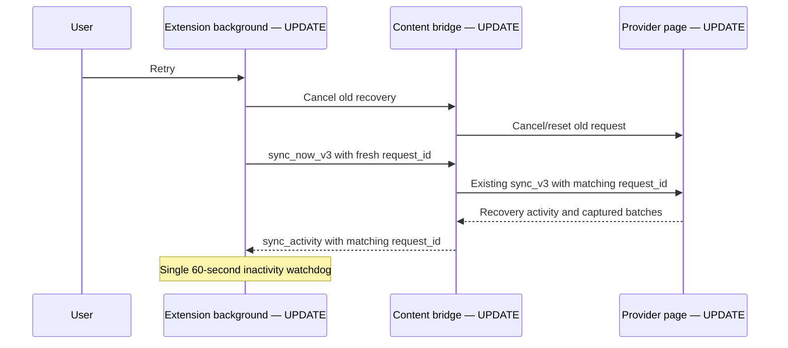

# Active-shop connection recovery

**Planned — source under review, not deployed.** Each Chrome profile may import the same configuration for all shops. Live sockets, API pings and leader actions should follow the shop identified by the open Shopee session. Saved configuration is not proof of a live session.

[Shared overview](https://github.com/kaojai-ai/kj-wiki/blob/docs/omnichat-reliability-plan/openwiki/repositories/omnichat-bridge.md) · [Delivery issue](https://github.com/kaojai-ai/backlog/issues/65)

## System flow

```mermaid
sequenceDiagram
    participant S as Shopee chat tab — UPDATE
    participant E as Extension — UPDATE
    participant B as Bridge Lambda — UPDATE logging
    participant D as DynamoDB — UNCHANGED
    E->>S: Chrome message: get_provider_status_v3
    S-->>E: current_provider_account_id and capture freshness
    E->>B: Existing authenticated ticket and WebSocket status
    B->>D: Existing presence contract
    Note over S,E: Bounded requests; only signed-in shop owns a socket
```

## Component changes

| Owner | Before | Planned behaviour |
| --- | --- | --- |
| omnichat-bridge: background | Saved detected shops can all own live connections | Resolve current session; close inactive sockets; retain configuration and queued messages |
| omnichat-bridge: recovery | Retry backoff can hide a recovered tab | Keep health checks running; back off reload attempts only |
| omnichat-bridge: capture | Fetch or JSON parsing can hold the polling lock indefinitely | Bound provider requests to 15 seconds; release lock; ignore completion from an old shop session |
| omnichat-bridge: readiness | Successful list polling can hide message-history failure | Report capture failure and apply existing freshness checks to ready status |
| omnichat-bridge: delivery | Upload can delay watchdog; retry timestamp is not enforced | Bound upload/log requests to 15 seconds; independent transport repair; respect automatic retry time |
| omnichat-bridge: popup | All configured shops can look ready | Show only the signed-in Shopee shop; hide inactive shops; show unknown explicitly |
| stateless-apps: bridge Lambda | Connection log context can use global tenant | Use authenticated ticket tenant context, without new database reads |

## Database and contracts

**Database changes: none.** No tables, indexes, grants, migrations or new infrastructure. Existing HMAC, ticket, message queue and WebSocket contracts remain unchanged. The extension's local `active_in_profile` flag is private browser storage, not a server contract.

Example existing status: `{ "ready": false }` when capture is stale or failed. Existing `current_provider_account_id` identifies the signed-in shop; configured IDs are not substituted when detection is unavailable. A missing session can temporarily show unknown until the tab responds.

## Impact and validation

1. Prevent indefinite stalls and misleading readiness. Tests cover hung fetch/body, recovery during backoff and session changes.
2. Isolate profile ownership. Test switching between two configured shops, retiring predecessor sockets and preserving queued messages.
3. Make support status understandable. Only the signed-in Shopee shop is shown using the existing plain account row, without an extra card border or session label. LINE retains multiple OA accounts per profile. Already captured queues for inactive shops may finish uploading without accessing those provider sessions.
4. Correct tenant attribution without per-heartbeat logging or new network calls.

No heartbeat frequency increase, provisioned concurrency or warm-up scheduler. Fewer inactive connections should reduce unnecessary traffic, but exact savings require post-release measurement. Provider read/upload deadlines do not retry outgoing customer sends or alter uncertain-send handling.

## Rollout and remaining work

Extension and logging changes are independently compatible; neither requires a schema rollout. Merge and deployment require authorization. Validate the released extension with multiple Chrome profiles sharing config, provider login/switch, tab refresh, failed history reads, and an actual two-hour WebSocket rotation.

The production bridge was observed without APP_ENV/KJ_RUNTIME_ENVIRONMENT even though current Terraform declares them. Reconcile through the existing reviewed infrastructure workflow separately; do not guess environment from a socket URL. No production configuration is changed by this patch.

Heartbeat acknowledgements and half-open socket detection remain phase two. The observed customer disconnect after two hours is not conclusively explained by server logs alone. This patch addresses reproduced failure paths; production resolution must be verified after rollout. Existing send-worker execute/ack budgets stay unchanged.

## Manual retry and timeout ownership

**Planned refinement.** Manual Retry replaces the active recovery, including an automatic attempt. It aborts and detaches the old run, sends a bounded cancellation, resets the selected Shopee page recovery, and starts a fresh run with a new attempt ID. Duplicate clicks during cancellation share one restart. Automatic triggers join the current run. Capture queues and cursors remain; outgoing customer sends are never replayed by this action. The popup keeps Retry available during syncing and ignores responses from superseded clicks.



| Limit | Owner and purpose |
| --- | --- |
| 15-second request deadline | Shopee polling/initial-history fetch and body reads; background ingestion/log uploads. Cancels stuck I/O. |
| 60 seconds without progress | Background recovery handoff. Matching activity from the selected tab refreshes it; expiry cancels that request. No fixed total-sync cutoff. |
| 5-second bridge control checks | Status, ping and cancellation acknowledgements. A dead tab cannot hold the Retry handoff indefinitely. |
| Existing operation-specific limits | Surface preparation uses its 30-second page wait plus a 35-second transport guard; local queue acknowledgements, WebSocket ticket/handshake, and outgoing-send deadlines remain separate contracts. |

Removed: content-owned recovery inactivity timer and background fixed 90-second sync timer. The progress notification is local Chrome messaging, not a server heartbeat. Content reports `recovery_watchdog_version: 1` in its ping so open tabs with older code are reattached before recovery. No server or database contract changes.

Representative internal contracts: `sync_now_v3 { request_id: "attempt-uuid", provider, provider_account_id }` and `sync_activity { request_id: "attempt-uuid" }`. Only the active attempt from the selected tab refreshes the watchdog. Stale progress cannot overwrite the replacement's status. Cancellation during checkpoint loading prevents a late page-side start.

Acceptance covers a hung initial fetch/body followed by successful retry, a long recovery making progress past 90 seconds, silence cancellation, duplicate Retry clicks, cancellation during checkpoint loading, stale-tab progress and late completion of a superseded run. Actual installed-extension recovery still needs release validation.


### Popup processing feedback (Planned)

The existing status area now distinguishes account detection, opening provider chat, server connection recovery, live Shopee connection readiness, and message recovery phases. An empty discovery result does not imply missing configuration: saved provider configuration produces a waiting-for-account state; missing configuration is shown after discovery completes. Retry feedback survives storage refreshes until actual recovery progress takes over. A completed history check does not imply that live commands are ready. No extra polling, server requests, database changes, cards, or account badges are added. Current provider progress comes from existing local storage fields, including `provider_realtime_connected`.

Popup status colors use neutral gray for processing/waiting/setup, green for confirmed ready/success, and red for failures. The existing node badge remains exclusively node/leader status. Account rows and the existing status area show inline spinners for active discovery, chat opening, reconnecting, and sync phases; idle/setup/error states do not. Animation respects reduced-motion preferences. This changes presentation only.
